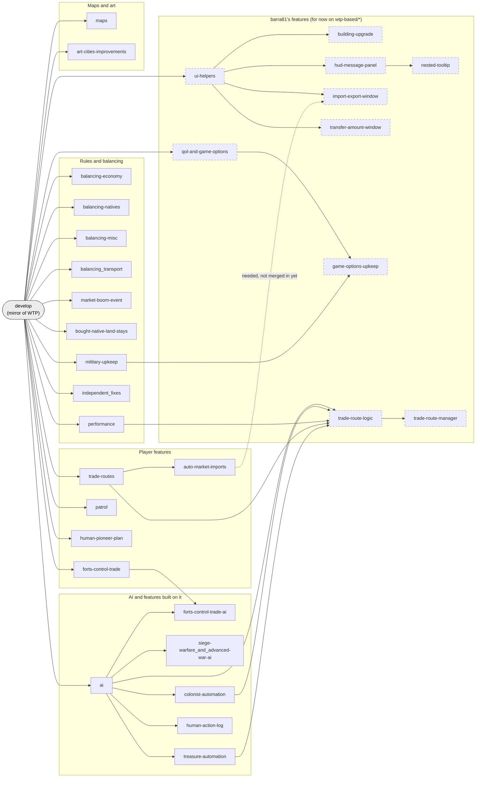

# Branches

Every feature lives on its own `feature/<name>` branch. A feature branch starts from WTP's `develop`
whenever possible, so it can also be offered to the We the People team. Some features build on others;
their branch then starts from those (or from a merge of them).

An arrow points from the branch a feature is built on to the feature.

## Other branches

| Branch | Role |
|---|---|
| `develop` | unchanged mirror of WTP's `develop`; never commit to it |
| `main` | `develop` + all merged `feature/*` branches; the play and release branch (protected, changes only by pull request) |
| `test/all` | `main` + feature branches that are still being tested; rebuilt and force-pushed, never merged into `main`; do not base work on it |
| `wtp-based/<name>` | barra81's features, built on `develop`; to be renamed into the `feature/<name>` structure |
| `review/<name>` | the content of a pull request into `feature/<name>` (e.g. barra81's features); deleted after the merge |

## How a change gets in

1. New work goes on the matching `feature/<name>` branch, or on a new one started from `develop`
   (or from the feature it needs).
2. The feature branch is merged into `main`.
3. Fixes that are only needed when two features meet go on a branch of their own that merges both
   (like `forts-control-trade-ai`), not directly on `main`.
